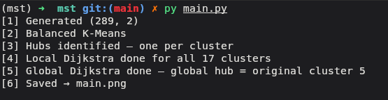

# Hierarchical Dijkstra Pipeline

A two-level shortest-path pipeline that partitions random 2-D points into
balanced clusters, runs Dijkstra locally inside each cluster, then runs a
second Dijkstra across the cluster hubs to form a global routing tree.

With the default 289 points this produces 17 clusters of 17 points each.

---

## How It Works

The pipeline runs seven steps, each wrapped in its own function:

| Step | Function | What it does |
|------|----------|--------------|
| 0 | `get_num_cluster` | Derives the number of clusters as `round(√total_points)` and computes the allowed cluster size range (`floor`/`ceil` of √) |
| 1 | `generate_points` | Generates `total_points` random 2-D integer points in `[-N, N)` |
| 2 | `cluster_points` | Balanced K-Means — clusters are constrained to `size_min`/`size_max` points each |
| 3 | `build_clusters` | Finds each cluster's hub (point closest to centroid) and moves it to index 0 |
| 4 | `run_local_dijkstra` | Builds a complete squared-distance graph per cluster and runs Dijkstra from the hub |
| 5 | `run_global_dijkstra` | Same, but on all hubs — finds the global hub and its shortest-path tree |
| — | `get_tree_edges` | Reconstructs an edge list from Dijkstra's predecessor array |
| 6 | `visualize` | Renders a two-panel matplotlib figure and saves it to `main.png` |

Input is handled by `get_input`, which parses optional CLI arguments (see [Usage](#usage)).  
All steps are orchestrated by `main()`.

### `get_num_cluster`

The number of clusters is not a fixed constant — it is derived from the input size:

```
n_clusters = round(√total_points)
size_min   = floor(√total_points)
size_max   = ceil(√total_points)
```

This keeps clusters roughly square (equal width and height in point count) and lets `KMeansConstrained` absorb any remainder by allowing each cluster to hold either `size_min` or `size_max` points. For a perfect square like 289, all three values collapse to 17. For a non-square like 300 (√ ≈ 17.32), you get 17 clusters of either 17 or 18 points.

---

## Requirements

```
numpy
scipy
matplotlib
k-means-constrained
```

Install with:

```bash
pip install numpy scipy matplotlib k-means-constrained
```

---

## Usage

```bash
python main.py [points] [seed]
```

Both arguments are optional positional arguments:

| Argument | Default | Description |
|----------|---------|-------------|
| `points` | `289`   | Total number of random 2-D points to generate |
| `seed`   | `42`    | NumPy / K-Means random seed for reproducibility |

Examples:

```bash
python main.py            # 289 points, seed 42 (default)
python main.py 400        # 400 points, seed 42
python main.py 400 7      # 400 points, seed 7
```

Expected output (defaults):

```
[0] Cluster Size 17
[1] Generated (289, 2)
[2] Balanced K-Means
[3] Hubs identified — one per cluster
[4] Local Dijkstra done for all 17 clusters
[5] Global Dijkstra done — global hub = original cluster <N>
[6] Saved → main.png
```

The plot is saved as **`main.png`** in the working directory.

---

## Demo

### Terminal Output




### Saved Plot (`main.png`)


#### **Panel A — Local clusters**  
Each colour is one cluster. Faint lines show the complete squared-distance graph;
bold lines show the Dijkstra shortest-path tree rooted at the hub (★).

#### **Panel B — Global hubs**  
Each cluster is reduced to its hub node. The purple tree is the global
Dijkstra shortest-path spanning tree; the red star (★) is the global hub —
the hub closest to the centroid of all hubs.

---
