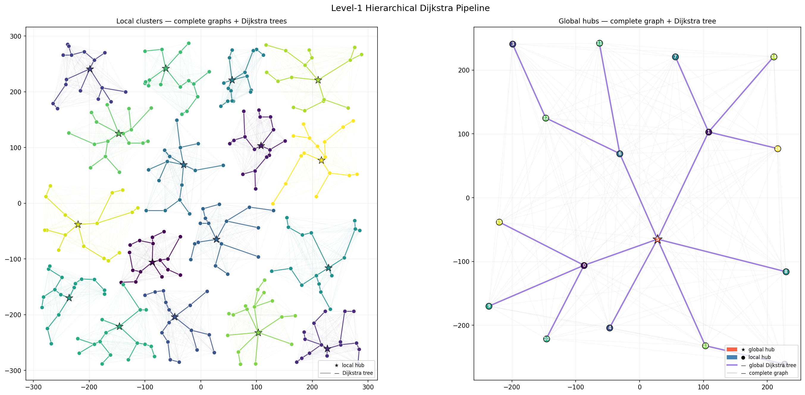

# Hierarchical Dijkstra Pipeline

A two-level shortest-path pipeline that partitions 289 random 2-D points into
17 equal-sized clusters, runs Dijkstra locally inside each cluster, then runs a
second Dijkstra across the 17 cluster hubs to form a global routing tree.

---

## How It Works

The pipeline runs seven steps, each wrapped in its own function:

| Step | Function | What it does |
|------|----------|--------------|
| 1 | `generate_points` | Generates 289 random 2-D integer points |
| 2 | `cluster_points` | Balanced K-Means — exactly 17 points per cluster |
| 3 | `build_clusters` | Finds each cluster's hub (point closest to centroid) and moves it to index 0 |
| 4 | `run_local_dijkstra` | Builds a complete squared-distance graph per cluster and runs Dijkstra from the hub |
| 5 | `run_global_dijkstra` | Same, but on the 17 hubs — finds the global hub and shortest-path tree |
| — | `get_tree_edges` | Reconstructs edge list from Dijkstra's predecessor array |
| 6 | `visualize` | Renders a two-panel matplotlib figure and saves it to `main.png` |

All steps are orchestrated by `main()`.

---

## Requirements

```
numpy
scipy
matplotlib
k-means-constrained
```

Install with:

```bash
pip install numpy scipy matplotlib k-means-constrained
```

---

## Usage

```bash
python main.py
```

Expected output:

```
[1] Generated (289, 2)
[2] Balanced K-Means
[3] Hubs identified — one per cluster
[4+5] Local Dijkstra done for all 17 clusters
[6] Global Dijkstra done — global hub = original cluster <N>
[7] Saved → main.png
```

The plot is saved as **`main.png`** in the working directory.

---

## Configuration

Edit the constants at the top of `main.py`:

```python
NUM_CLUSTERS       = 17   # number of clusters
POINTS_PER_CLUSTER = 17   # points per cluster (balanced)
TOTAL_POINTS       = NUM_CLUSTERS * POINTS_PER_CLUSTER  # derived
RANDOM_SEED        = 42
```

---

## Demo

### Terminal Output


### Saved Plot (`main.png`)



**Panel A — Local clusters**  
Each colour is one cluster. Faint lines show the complete squared-distance graph;
bold lines show the Dijkstra shortest-path tree rooted at the hub (★).

**Panel B — Global hubs**  
Each cluster is reduced to its hub node. The purple tree is the global
Dijkstra shortest-path spanning tree; the red star (★) is the global hub —
the hub closest to the centroid of all hubs.

---

## Project Structure

```
.
├── main.py       # pipeline source
├── main.png      # output plot (generated on first run)
└── README.md
```
